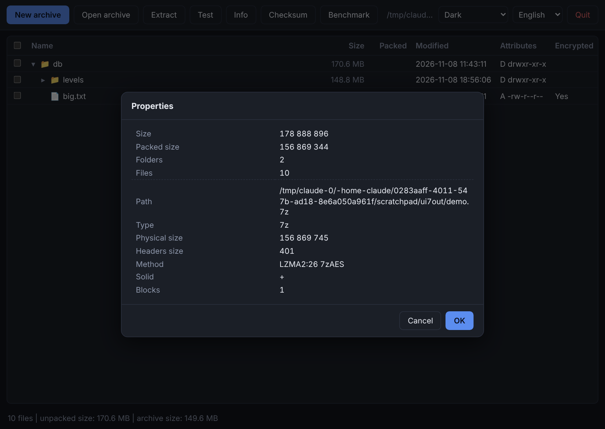
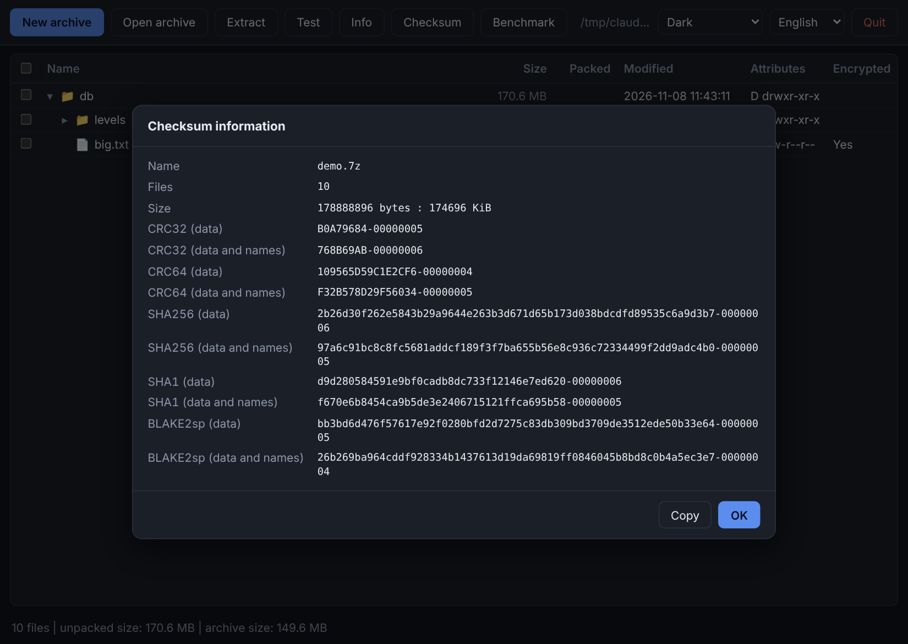
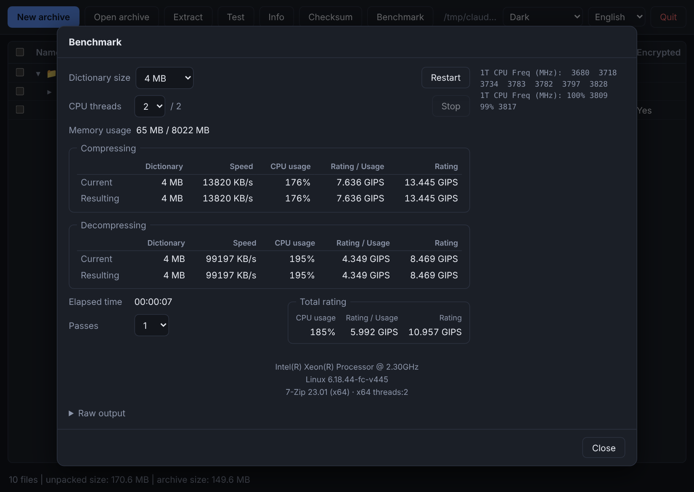

# 🗜️ Universal 7-Zip GUI


A single Python file that gives the 7-Zip console program (`7zz` / `7z.exe`) a graphical interface, modeled on the Windows 7-Zip windows. No Tk, no Qt, no pip packages. It starts a small local server and shows the interface in your browser (or in an app-style Chromium window if one is found).

7-Zip stays a separate, replaceable part: put the 7-Zip files in the same folder as the script, and to update, drop the new release over the old files. The script never has to change.

## 🚀 Key Features

* ✅ **Zero dependencies:** Python 3 standard library and a web browser. Nothing to install with pip.
* ✅ **Modular 7-Zip:** Looks for 7-Zip next to the script first, then in `PATH` and the usual install folders. Updating 7-Zip means copying new files over the old ones.
* ✅ **All packing formats:** 7z, zip, tar, gzip, bzip2, xz and wim, plus `tar.gz`, `tar.bz2` and `tar.xz`. Opens and extracts everything else 7-Zip can read (RAR, ISO, CAB, VHD, DMG and many more).
* ✅ **"Add to Archive" window:** Compression level and method (LZMA2, LZMA, PPMd, BZip2, Deflate, Deflate64, Copy), dictionary size, word size, solid block size, CPU threads, memory limit, split to volumes, extra parameters, update mode, path mode, SFX, shared files (Windows), delete after compression. Choices follow the selected format and method.
* ✅ **Encryption:** Password with confirmation and show/hide, AES-256 or ZipCrypto, encrypted file names for 7z.
* ✅ **Progress window:** Elapsed and remaining time, files, total size, speed, processed, compressed size, ratio, plus Background, Pause and Cancel.
* ✅ **Archive properties:** Type, method, solid, blocks, headers size and more.
* ✅ **Checksums:** CRC32, CRC64, SHA-1, SHA-256, BLAKE2sp and other hashes of files on disk, a whole archive or selected items, with a copy button.
* ✅ **Benchmark:** Live compress and decompress ratings with dictionary size and thread selection.
* ✅ **Private by design:** The server listens on `127.0.0.1` only, with a random access token and a Host header check. Nothing leaves your computer. The only thing stored in the browser is your language and theme choice.
* ✅ **Themes:** System (follows light/dark automatically, the default), Light, Dark and a pure `#000000` OLED theme.
* ✅ **7 languages:** English, Türkçe, Deutsch, Français, Español, Русский and 简体中文, selected automatically from your browser language.

## 💻 Usage

[!NOTE] Python 3 and a copy of the 7-Zip console program are all you need.

**Linux**

1. Download the `Linux x86-64` archive from [7-zip.org](https://www.7-zip.org/) and extract it into an empty folder (it contains `7zz`)
2. Put `7zgui.py` in the same folder
3. Run `python3 7zgui.py`

**Windows**

1. Install 7-Zip, or take `7za.exe` / `7zr.exe` from the 7-Zip "Extra" package
2. Put `7zgui.py` next to `7z.exe` (or keep `7z.exe` in `PATH`)
3. Run `py 7zgui.py` (rename the file to `7zgui.pyw` to hide the console window)

**macOS**

1. Get `7zz` from [7-zip.org](https://www.7-zip.org/) or `brew install sevenzip`
2. Put it next to `7zgui.py` or in `PATH`
3. Run `python3 7zgui.py`

**Command line**

```
python3 7zgui.py                     # empty window
python3 7zgui.py archive.7z          # open an archive directly
python3 7zgui.py --add file folder   # open "Add to Archive" with these sources
```

Options: `--no-browser` only prints the address, `--port N` picks a port, `--no-app` skips the Chromium app-window mode.

**Updating 7-Zip:** extract the new release into the same folder and overwrite the old files.

Notes: 7-Zip itself is not included and is not part of this repository. Developed and tested on Linux with 7-Zip 23.01. The Windows and macOS code paths are written but have not been tested yet. `gzip`, `bzip2` and `xz` hold a single file only, so for folders choose `tar.gz`, `tar.bz2` or `tar.xz`. Opening a `tar.*` file shows the inner `.tar`, which you extract and open in a second step.

## 📸 Screenshots

(Light theme)


(Pure Black OLED theme)


(Add to Archive)


(Progress)


(Archive properties)


(Checksum information)


(Benchmark)


## 📄 License

Copyright (C) 2026 Oktay Mercan https://github.com/OKTAYMERCAN/Universal-7zip-GUI

---
AI used.
