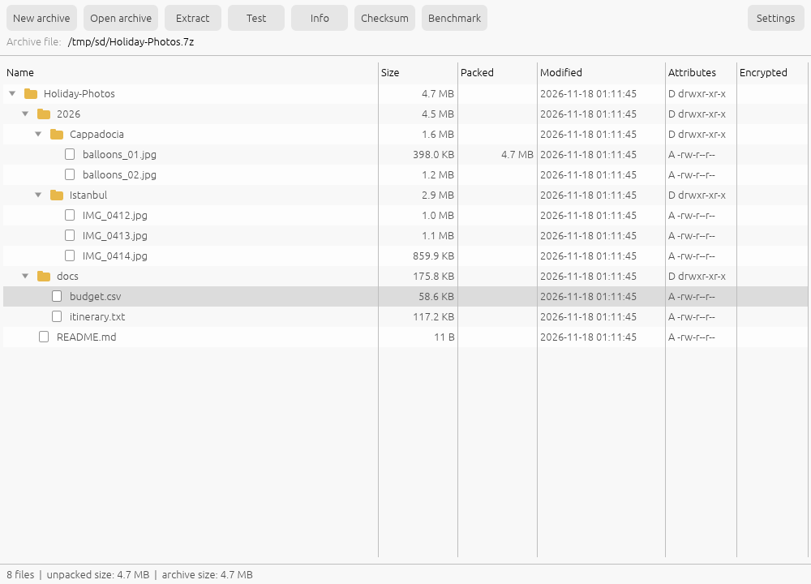
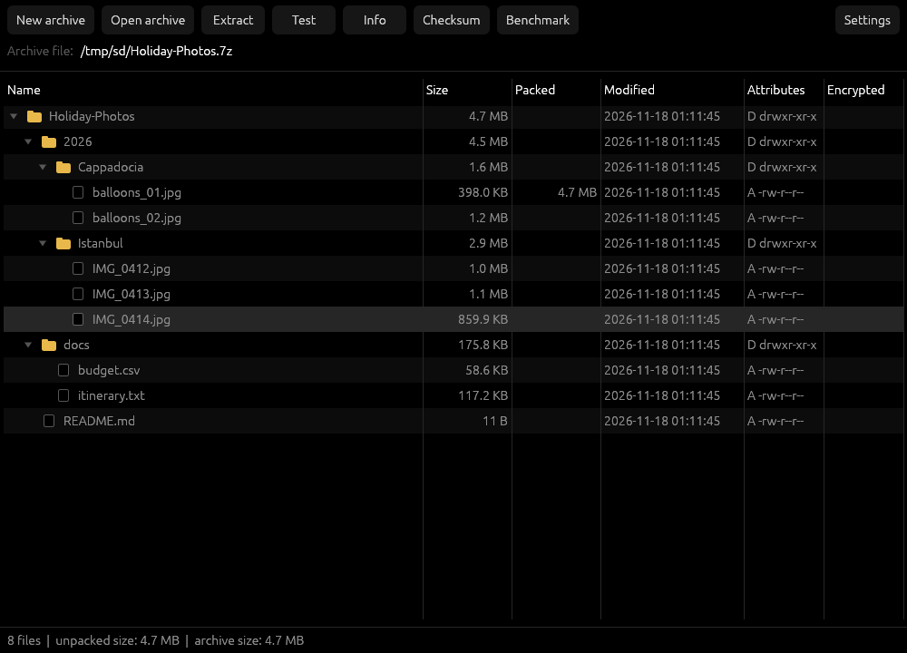
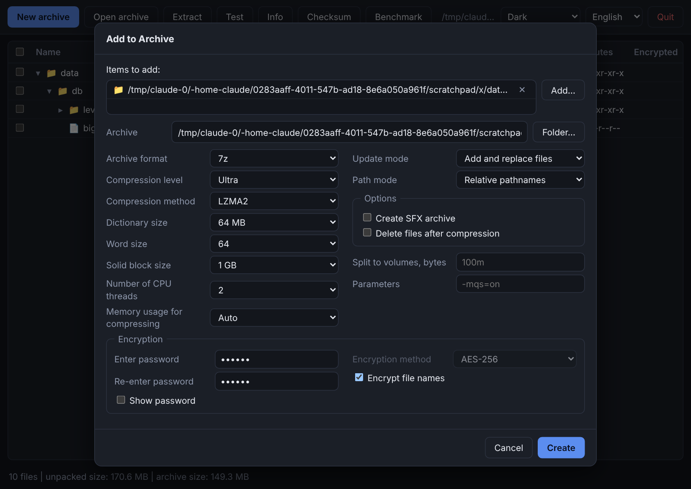
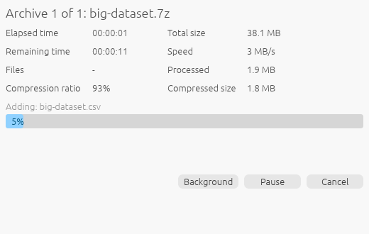
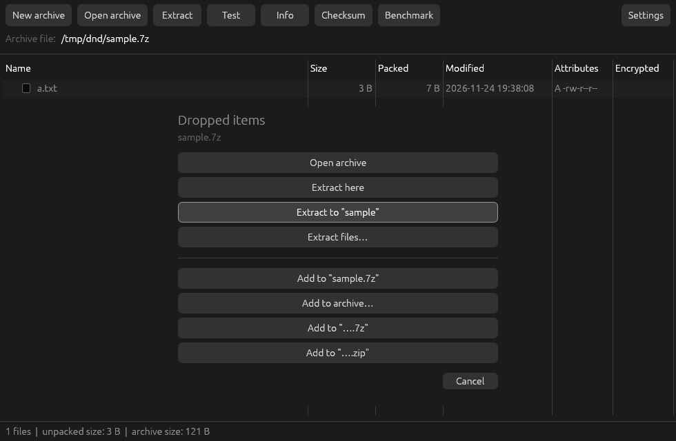
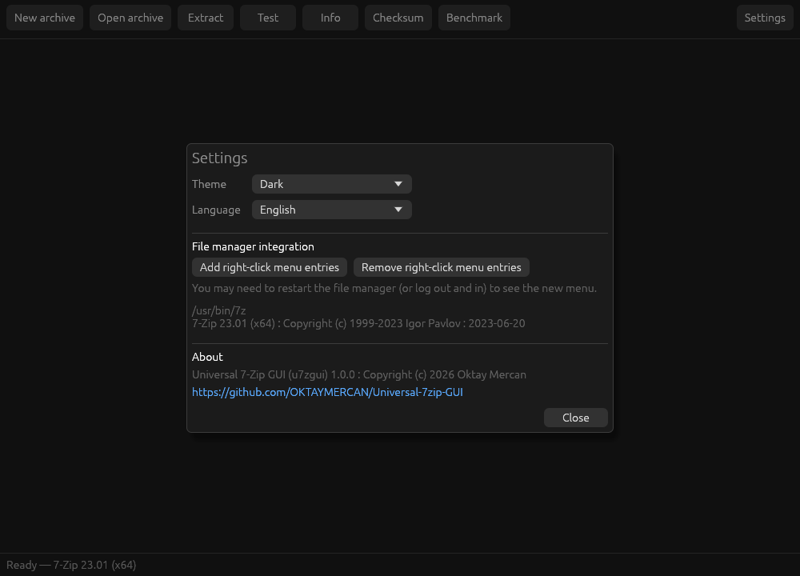

# 🗜️ Universal 7-Zip GUI


A native desktop program for the 7-Zip console version (`7zz` / `7z` / `7z.exe`), written in Rust. It opens like any normal archive program, with no browser and no web server, and it can add **right-click entries to your file manager** (Extract here, Extract to folder, Add to archive…), like WinRAR, WinZip or 7-Zip on Windows.

This is the native (Rust) version. The earlier Python/browser version is kept in the [`old version`](old%20version/) folder of this repository. Same windows, same options, same 7 languages. The compression itself is still done by 7-Zip, so the packing speed is exactly the speed of 7-Zip; what you gain is a fast-starting program of a few MB, no Python, and the file manager integration.

7-Zip stays a separate, replaceable part: put the 7-Zip files in the same folder as the program, and to update, drop the new release over the old files. The program never has to change.

## 🚀 Key Features

* ✅ **Native window:** One executable, no runtime, no browser. Starts instantly and uses little memory.
* ✅ **Right-click integration:** `Extract files…`, `Extract here`, `Extract to "folder"`, `Test archive`, `Add to archive…`, `Add to "….7z"`, `Add to "….zip"` and `Checksum`, installed per user with one button (Settings) or `u7zgui install-shell`. No administrator rights.
* ✅ **Modular 7-Zip:** Looks for 7-Zip next to the program first, then in `PATH` and the usual install folders.
* ✅ **All packing formats:** 7z, zip, tar, gzip, bzip2, xz and wim, plus `tar.gz`, `tar.bz2` and `tar.xz`. Opens and extracts everything else 7-Zip can read (RAR, ISO, CAB, VHD, DMG and many more).
* ✅ **"Add to Archive" window:** Compression level and method (LZMA2, LZMA, PPMd, BZip2, Deflate, Deflate64, Copy), dictionary size, word size, solid block size, CPU threads, memory limit, split to volumes, extra parameters, update mode, path mode, SFX, shared files (Windows), delete after compression. Choices follow the selected format and method.
* ✅ **Encryption:** Password with confirmation and show/hide, AES-256 or ZipCrypto, encrypted file names for 7z.
* ✅ **Progress window:** Elapsed and remaining time, files, total size, speed, processed, compressed size, ratio, plus Background, Pause and Cancel. Right-click actions show only this window and close themselves when finished (they stay open with the log if something fails).
* ✅ **Archive browser:** Folder tree with sizes, double-click a file to open it with the default program, right-click a row for Extract / Test / Info.
* ✅ **Drag and drop:** Drop archives or files on the window and choose: open, extract here, extract to a folder, extract with options, add to the open archive, add to a new archive or quick `.7z` / `.zip`. Drop files onto the "Add to archive" window to add them, or a folder onto the "Extract" window to set the destination. (Dragging items *out* of the archive list into the file manager is not possible with this GUI toolkit; use Extract or the right-click menu.)
* ✅ **Separate, movable windows:** Every dialog opens as its own window that you can move, resize and place on another screen.
* ✅ **Archive properties, checksums (CRC32, CRC64, SHA-1, SHA-256, BLAKE2sp…) and a benchmark** with live ratings, like the Windows 7-Zip.
* ✅ **Themes:** System (follows light/dark automatically, the default), Light, Dark and a pure `#000000` OLED theme.
* ✅ **7 languages:** English, Türkçe, Deutsch, Français, Español, Русский and 简体中文, selected automatically from the system language.
* ✅ **Private by design:** No network access at all. Settings are a tiny JSON file in your user config folder.

## 💻 Usage

[!NOTE] Download the Linux program from the [Releases](../../releases) page (Windows and macOS builds come from the **Actions** artifacts, or build it yourself with `cargo build --release`), and put a copy of the original 7-Zip console program next to it. 7-Zip is not bundled: you add the official files yourself, so updating 7-Zip is just copying the new files over the old ones.

**Linux**

1. Download the `Linux x86-64` archive from [7-zip.org](https://www.7-zip.org/) and extract it into the same folder as `u7zgui` (it contains `7zz`), or install `7zip` / `p7zip-full` with your package manager
2. Run `./u7zgui`
3. Settings → **Add right-click menu entries**. Supported: Dolphin (KDE), Nemo, Nautilus and Caja (Scripts menu), Thunar and an "Open with" launcher. Restart the file manager once.

**Windows**

1. Install 7-Zip, or put `7za.exe` / `7zr.exe` from the 7-Zip "Extra" package next to `u7zgui.exe`
2. Run `u7zgui.exe`, Settings → **Add right-click menu entries** (writes only to `HKCU`, undone with the remove button). On Windows 11 the entries are under "Show more options".

**macOS**

1. `brew install sevenzip`, or put `7zz` next to `u7zgui`
2. Run `./u7zgui`, Settings → **Add right-click menu entries** (creates Finder Quick Actions in `~/Library/Services`)

**Command line**

```
u7zgui                              # main window
u7zgui archive.7z                   # open an archive
u7zgui file1 folder2                # "Add to archive…" with these items
u7zgui add <paths...>               # same, explicit
u7zgui quick-add 7z <paths...>      # archive with defaults, only a progress window
u7zgui extract <archive>            # "Extract…" window
u7zgui extract-here <archives...>   # next to the archive
u7zgui extract-to <archives...>     # into a folder named after the archive
u7zgui test <archives...>
u7zgui hash <paths...>              # checksum window
u7zgui install-shell | uninstall-shell
```

**Updating 7-Zip:** extract the new release into the same folder and overwrite the old files.

Notes: 7-Zip itself is not included and is not part of this repository. Developed and tested on Linux with 7-Zip 23.01. The Windows and macOS code paths (registry entries, Quick Actions, priority and pause calls) are written but have **not been tested yet**; the GitHub Actions workflow compiles all three systems. `gzip`, `bzip2` and `xz` hold a single file only, so for folders choose `tar.gz`, `tar.bz2` or `tar.xz`. Opening a `tar.*` file shows the inner `.tar`, which you extract and open in a second step. For Chinese the program loads a system CJK font; if none is installed the text shows as boxes.

## 🛠️ Build

```
cargo build --release      # needs Rust; on Linux also libxkbcommon, wayland and X11 development packages
cargo test --release       # uses the real 7-Zip if it is found
```

GUI: [egui](https://github.com/emilk/egui) / eframe. Everything else is the standard library plus `regex`, `serde_json`, `png` and `libc`.

## 📸 Screenshots

(Light theme)


(Pure Black OLED theme)


(Add to Archive)


(Progress, as shown by the right-click actions)


(Drop choice)


(Archive properties)


(Checksum information)


(Benchmark)


(Settings and About)


## 📄 License

Copyright (C) 2026 Oktay Mercan https://github.com/OKTAYMERCAN/Universal-7zip-GUI

This program is free software: you can redistribute it and/or modify it under the terms of the GNU General Public License version 3. See [LICENSE](LICENSE).

---
AI used.
